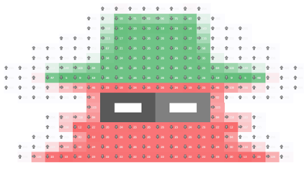
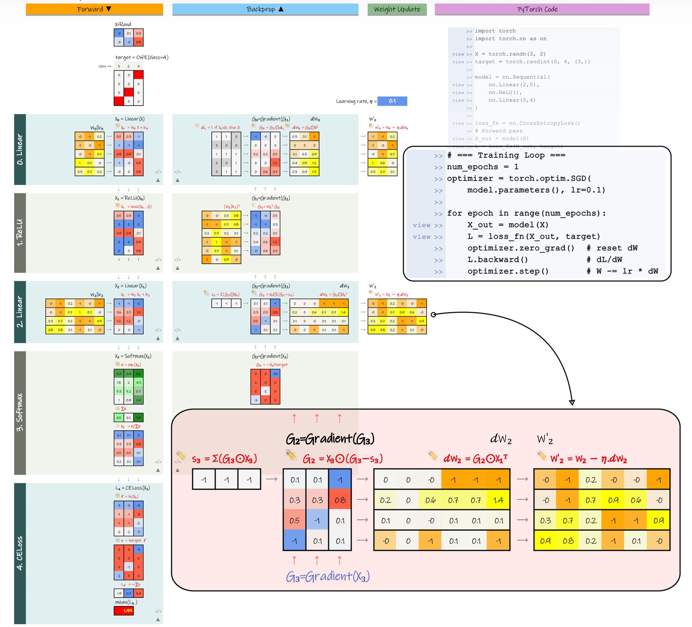

<p align="center">
  
</p>

# Hack Propagation

Interactive **backpropagation, parameter updates, and training diagnostics** in
Microsoft Excel. This standalone codebase retains the original forward
calculations, backward blueprint, training epochs, final inference view, and
dashboard, together with a linked **PyTorch Code** panel containing the model,
loss, and SGD training loop. Backpropagation is always enabled.

To restore the code panel in an existing workbook, replace your installed
**HackPropagation** Office Script with the complete contents of `src/main.ts`,
save it, and run it again. Associate that script with the workbook's Run button
if needed. Existing buttons may still reference an older shared OneDrive script;
pulling this repository does not update scripts stored in OneDrive.

The generated PyTorch code uses random example inputs, targets, and model weights.
It illustrates the architecture and training steps; it does not export the exact
values edited in Excel. Open the panel using **PyTorch Code** on `Architect` or
the code links beside Blueprint blocks.



*Illustration of forward calculations, gradient flow, and weight updates. The PyTorch code panel shows the corresponding model and training loop.*

## Run in Excel

1. Open `HackPropagation.xlsx` in Excel with Office Scripts and dynamic arrays enabled.
2. In **Automate → New Script**, replace the example with the complete contents of
   `src/main.ts`. Save the script as **HackPropagation**.
3. On the `Architect` worksheet, configure the network in **B5:D50**: layer,
   output dimension, and input batch size. End with **CELoss** or **MSELoss**.
   The included workbook already has a runnable classification example.
4. Set the epoch count in **H5** to a whole number from **1 to 200**. As in the
   original project, this counts the initial Blueprint state: H5=1 creates
   Blueprint with no additional epoch sheets; H5=3 also creates ep1 and ep2.
5. Run **HackPropagation** from Automate. It replaces the old backprop toggle with
   a mode label and generates the blueprints
   and dashboard. Follow the links from `Architect` to explore them.
6. Inspect the learning-rate field in Blueprint and the forward, backward, and
   weight-update columns. Use Dashboard for loss, gradients, parameter updates,
   and mean gradients across epochs. Architecture changes require another run.

Keep the `Architect`, `Helper`, and `tinyDigits` worksheets: the original worksheet
name is retained for existing formula/navigation compatibility. The workbook is a
complete copy of the upstream template, preserving native formatting, validation,
the image grid, and all 110 tinyDigits samples. Its initial appearance is the
upstream interface until the first script run. The old buttons reference external
OneDrive scripts; run this project's scripts from Automate or associate the included
source with a new worksheet button. The scripts preserve worksheet buttons.

For optional tools, create separate Office Scripts from `src/RandomInputs.ts`
(random network with loss) and `src/ClearButton.ts` (clear network/results).
Each has its own `main`; do not combine them in one editor. These tools keep
HackPropagation in backpropagation mode and reset H5 to 1.

`scripts/*.osts` contains the same scripts in Office Script file format. Use the
`.ts` files when pasting into Automate, not the `.osts` JSON. Running in Excel
requires no other project, server, API key, Node, or Python installation.

## Develop and check

Requires Node.js 18+ only for local development:

```sh
npm ci
npm run check
```

Edit `src/*.ts`, then run `npm run build` to regenerate `scripts/*.osts`.
Integration tests execute generation and regeneration with classification,
regression, normalization, and image networks in an in-memory Office Scripts host.
They check backward outputs, epoch links, dashboard/chart creation, and invalid
settings. They inspect formula text without evaluating Excel formulas or verifying
live rendering. Before release, run in Excel with H5=1 and H5=3, inspect backward
and update values, and verify dashboard charts and input/learning-rate recalculation.

See `UPSTREAM.md` for provenance. This project does not import or load anything from
The Architect or the browser-based HackProp project.
